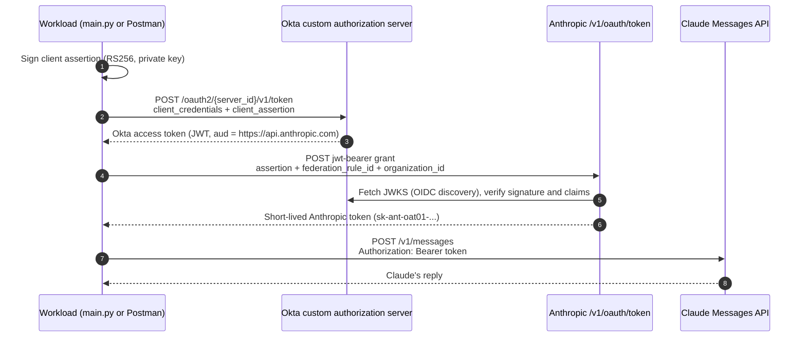

# Okta → Anthropic Workload Identity Federation (WIF)

Call the Claude API **without a static API key**, using Okta as the identity provider. This repo shows the same flow two ways:

| | What it is | Start here |
|---|---|---|
| 🐍 **Python** | A single-file script (`main.py`) you can drop into a workload | [Setup](#setup) below |
| 📮 **Postman** | A documented collection that runs each HTTP call one at a time, with scripts that decode tokens and explain errors | [`postman/`](postman/README.md) |

Both use the same Okta and Anthropic configuration, so steps 3 and 4 of the [Setup](#setup) apply to either.

A workload (a script, container or CI job) proves its identity to Okta with a private key. Okta returns a short-lived access token. Anthropic exchanges that token for an ephemeral Anthropic access token, which is then used to call Claude.



## Why

- **No long-lived secrets.** Nothing like an `sk-ant-api...` key sits in a config file, CI variable or vault.
- **Short-lived credentials.** The Okta client assertion lasts 5 minutes, and the Anthropic token expires on its own.
- **Central control.** Access is granted and revoked in Okta and in the Anthropic federation rule, not by rotating keys.

## How the flow works

| # | From → To | What happens |
|---|---|---|
| 1 | Workload (local) | Signs a short-lived JWT (the client assertion) with `workload_private_key.pem`. |
| 2 | Workload → Okta `/oauth2/<server_id>/v1/token` | Sends a `client_credentials` grant with `client_assertion_type=urn:ietf:params:oauth:client-assertion-type:jwt-bearer`. Okta verifies the signature against the app's registered public key and returns an access token for the `anthropic.access` scope. |
| 3 | Workload → Anthropic `/v1/oauth/token` | Sends the Okta token as a `urn:ietf:params:oauth:grant-type:jwt-bearer` assertion, with the federation rule, organization and service account IDs. |
| 4 | Anthropic (internal) | Fetches Okta's public keys through OIDC discovery, verifies the token's signature and claims against the federation rule, and returns a short-lived token for the service account. |
| 5 | Workload → Claude `/v1/messages` | Calls Claude with `Authorization: Bearer <anthropic token>`. |

## Before you start: two things that trip people up

**You need the Claude Developer Platform, not a Claude Pro subscription.** Claude Pro (claude.ai) is the chat product for people. Service accounts, workload identity and API billing live in the Anthropic Console at [platform.claude.com](https://platform.claude.com).

**You need an Okta custom authorization server, not the org authorization server.** The org authorization server (`https://<org>.okta.com`) issues tokens meant for Okta's own APIs: you can't set their audience, scopes or access policies. A custom authorization server (`https://<org>.okta.com/oauth2/<server_id>`) issues tokens for an external API such as Anthropic, with a custom audience, scopes and policies. Custom authorization servers come with Okta API Access Management, which Okta developer tenants include.

## Prerequisites

- An Okta tenant with API Access Management (a developer edition tenant works)
- An Anthropic organization on [platform.claude.com](https://platform.claude.com) with permission to manage workload identity. The final Claude call needs API credits; the token exchange works without them.
- Python 3.9+

## Setup

### Step 1: clone the repo and install the dependencies

```bash
git clone https://github.com/IAM-FSantos/okta_to_anthropic_wif.git
cd okta_to_anthropic_wif

python -m venv .venv
# Windows: .venv\Scripts\activate    macOS/Linux: source .venv/bin/activate
pip install -r requirements.txt
```

### Step 2: create the key pair

The workload signs its Okta login with an RSA private key, and Okta verifies it with the matching public key. Use either option.

**Option A (recommended): generate the key pair yourself.** The private key is created where it will be used and never passes through a browser.

The script also needs `joserfc`, which isn't in `requirements.txt` because only key generation uses it:

```bash
pip install joserfc
```

Save this as `generate_key.py` in the project folder, change `KID` to a name of your choice, and run `python generate_key.py`:

```python
import json
from cryptography.hazmat.primitives import serialization
from cryptography.hazmat.primitives.asymmetric import rsa
from joserfc.jwk import RSAKey

KID = "my-workload-key-01"  # Unique Key ID (kid); use the same value for OKTA_KEY_ID

# 1. Generate an RSA key pair
private_key = rsa.generate_private_key(public_exponent=65537, key_size=4096)

# 2. Save the private key (PEM). Keep it secure on the workload; never commit it.
private_pem = private_key.private_bytes(
    encoding=serialization.Encoding.PEM,
    format=serialization.PrivateFormat.TraditionalOpenSSL,
    encryption_algorithm=serialization.NoEncryption(),
).decode("utf-8")
with open("workload_private_key.pem", "w") as f:
    f.write(private_pem)

# 3. Print the public key (JWK) to paste into Okta
key = RSAKey.import_key(private_pem, parameters={"kid": KID, "use": "sig", "alg": "RS256"})
print("Saved private key to workload_private_key.pem")
print("\n--- PUBLIC JWK (paste into Okta) ---")
print(json.dumps(key.as_dict(private=False), indent=2))
```

It writes a 4096-bit private key to `workload_private_key.pem` and prints only the **public** key as a JWK. Copy the JWK; you'll paste it into Okta in step 3.

**Option B: let Okta generate the key pair.** While setting up the app in step 3, choose **Generate new key** instead of pasting a JWK. Okta displays the private key only once: copy it in PEM format and save it in the project folder as `workload_private_key.pem`, including the `BEGIN` and `END` lines. Use the key ID Okta shows as `OKTA_KEY_ID`.

Either way:

- Never share or commit the private key. `.gitignore` already excludes `*.pem` files.
- To keep the key elsewhere, set `OKTA_PRIVATE_KEY_PATH` to its path.

### Step 3: configure Okta

In the Okta Admin Console:

1. **Create the app.** Go to **Applications → Applications → Create App Integration → API Services**. Name it (for example `Claude-Anthropic-Workload`) and note the **Client ID** (`0oa...`).
2. **Add the public key.** Under **Keys and certificate**, click **Edit → Add key**. Paste the JWK from step 2 (or choose **Generate new key** for option B), click **Done**, then **Save**.
3. **Switch to key-based authentication.** Under **Client Credentials**, click **Edit**, change client authentication from **Client secret** to **Public key / Private key** (JWT assertion), and save.
4. **Turn off proof of possession.** Under **General Settings**, make sure **Require Demonstrating Proof of Possession (DPoP)** is not enabled. This script doesn't send DPoP proofs.
5. **Create the authorization server.** Go to **Security → API → Authorization Servers → Add Authorization Server**. Name it (for example `Anthropic API`) and set the audience to `https://api.anthropic.com`. Note its **ID** (`aus...`) and **Issuer URI**.
6. **Add the scope.** On that server's **Scopes** tab, add a scope named `anthropic.access`.
7. **Allow the app to request it.** On the **Access Policies** tab, create a policy assigned to your app, with a rule that allows the **Client Credentials** grant and the `anthropic.access` scope.

### Step 4: configure Anthropic

In the Anthropic Console ([platform.claude.com](https://platform.claude.com)), go to **Organization → Keys → Workload identity → Connect workload → New provider → Custom OIDC**. The wizard registers the issuer, creates a service account and creates a federation rule.

1. **Issuer**
   - **Issuer URL:** the Issuer URI of your Okta authorization server, for example `https://<org>.okta.com/oauth2/aus...`
   - **JWKS source:** OIDC discovery, with the issuer's discovery document and JWKS reachable from the public internet
2. **Federation rule**
   - **Subject (`sub`) claim:** your Okta **Client ID**. For a client credentials grant, Okta sets `sub` to the client ID.
   - **Workspaces:** the workspaces the workload may use. If you choose more than one, or all workspaces, you must set `ANTHROPIC_WORKSPACE_ID` in `.env`.
   - If you added custom claims in Okta, you can match those instead, using the claims map or a CEL condition.
3. **Service account:** select or create a dedicated service account (`svac_...`) with only the access the workload needs.

When you finish the wizard, note these IDs: the **federation rule ID** (`fdrl_...`), **organization ID** (a UUID), **service account ID** (`svac_...`) and **workspace ID** (`wrkspc_...`).

### Step 5: configure `.env`

```bash
cp .env.example .env    # Windows (cmd): copy .env.example .env
```

Open `.env` and fill in the values from steps 2 to 4. Every setting is described under [Configuration](#configuration).

### Step 6: run it

```bash
python main.py
```

Expected output:

```
[1/3] Requesting Okta OIDC token using private_key_jwt...
✅ Okta access token minted.

[2/3] Exchanging Okta token at Anthropic WIF endpoint...
✅ Federation successful! Ephemeral Anthropic token acquired.
Token lifetime: 600 seconds.

[3/3] Invoking Claude API with ephemeral token...
✅ Claude API invocation successful!
Response: ...
```

## Verify and audit

You can see each run in both consoles:

- **Anthropic Console:** go to **Organization → Keys → Workload identity → Authentication events**. A successful exchange shows as **Success**, meaning the Okta signature, `sub` claim and audience matched your federation rule. Failed attempts show here too, which helps when debugging a `401`.
- **Okta Admin Console:** go to **Reports → System Log** and filter by your app to see each token issuance.

## Configuration

| Variable | Required | Description |
|---|---|---|
| `OKTA_DOMAIN` | yes | Okta org domain, without `https://` (e.g. `dev-123456.okta.com`) |
| `OKTA_AUTH_SERVER_ID` | yes | ID of the custom authorization server from step 3 (`aus...`) |
| `OKTA_CLIENT_ID` | yes | Client ID of the API Services app from step 3 (`0oa...`) |
| `OKTA_KEY_ID` | yes | `kid` of the public key from step 2 |
| `OKTA_PRIVATE_KEY_PATH` | no | Path to the PEM private key (default `workload_private_key.pem`) |
| `OKTA_SCOPE` | no | Scope to request (default `anthropic.access`) |
| `ANTHROPIC_FEDERATION_RULE_ID` | yes | Federation rule ID (`fdrl_...`) |
| `ANTHROPIC_ORGANIZATION_ID` | yes | Anthropic organization ID (UUID) |
| `ANTHROPIC_SERVICE_ACCOUNT_ID` | yes | Service account the rule maps to (`svac_...`) |
| `ANTHROPIC_WORKSPACE_ID` | no | Workspace ID (`wrkspc_...`); required when the rule covers more than one workspace |
| `CLAUDE_MODEL` | no | Model for the test call (default `claude-opus-5-5`) |

## Troubleshooting

| Error | Likely cause |
|---|---|
| `Algorithm 'RS256' could not be found` | `cryptography` isn't installed. Run `pip install -r requirements.txt`. |
| Okta `invalid_client` | Wrong `OKTA_KEY_ID`, the private key doesn't match the registered public key, or the app still uses a client secret. |
| Okta `invalid_dpop_proof` or a DPoP error | Proof of possession is enabled on the app. Turn it off (step 3.4). |
| Okta `invalid_scope` / `access_denied` | The scope doesn't exist on the authorization server, or no access policy rule allows the client credentials grant. |
| Anthropic `401` on token exchange | The issuer, `sub` or audience in the Okta token doesn't match the federation rule, an ID is wrong, or `ANTHROPIC_WORKSPACE_ID` is missing for a multi-workspace rule. Check **Authentication events** in the Anthropic Console. |
| Claude API `400` "credit balance is too low" | Federation worked; the organization needs API credits (Console → Plans & Billing). |

## Using the official SDK in production

This script calls the endpoints with `requests` so each step of the flow is visible. In production, the official `anthropic` SDK can do the exchange and token refresh for you. Set `ANTHROPIC_FEDERATION_RULE_ID`, `ANTHROPIC_ORGANIZATION_ID` and `ANTHROPIC_IDENTITY_TOKEN` (or `ANTHROPIC_IDENTITY_TOKEN_FILE`) to the Okta token, then create a plain `anthropic.Anthropic()` client. Make sure `ANTHROPIC_API_KEY` is unset, because it takes precedence.

## Security notes

- `.env` and `*.pem` files are in `.gitignore`. **Never commit your private key.** If one is ever pushed, revoke it in Okta immediately; deleting the commit isn't enough.
- In real deployments, keep the private key in a secrets manager or KMS/HSM, not on disk.
- Scope the federation rule tightly: one service account, the minimum set of workspaces, and exact claim matches.

## Repository layout

```
.
├── main.py                 # Python implementation of the full flow
├── requirements.txt
├── .env.example            # Template for the Python script's settings
├── postman/
│   ├── README.md                                          # Postman guide: setup, variables, scripts, troubleshooting
│   ├── okta-to-anthropic-wif.postman_collection.json      # The collection (placeholders only)
│   └── okta-to-anthropic-wif.postman_environment.example.json  # Environment template
├── LICENSE
└── README.md
```

## License

[MIT](LICENSE)
